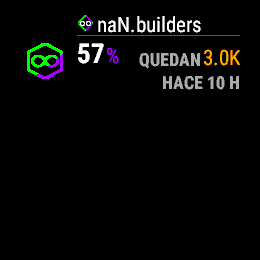
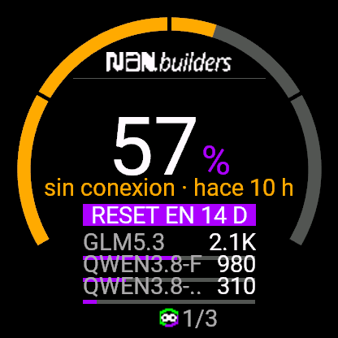
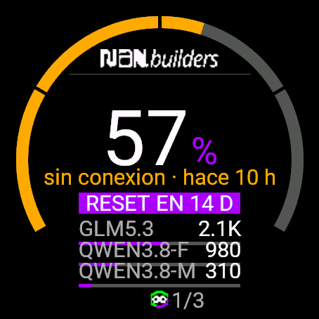

# NaN Usage

Widget Garmin que muestra el consumo de **créditos de tu cuenta de NaN Cloud** directamente en el reloj: cuánto llevas gastado del periodo, cuándo se resetea y qué modelos se lo están comiendo. Sin abrir el móvil.

| Glance (fr955) | Vista principal (fr265) | Vista principal (fr965) |
| --- | --- | --- |
|  |  |  |

- **% del periodo** con semáforo (verde/ámbar/rojo) y días hasta el reset (`RESET EN 14 D`)
- **Top 3 de modelos** por consumo de los últimos 30 días, con barra
- **Glance** siempre visible: créditos que quedan y edad del último dato
- **Caché en el reloj**: sin conexión muestra la última instantánea; red solo al abrir (batería primero)

## Instalar (sin Connect IQ Store)

1. Descarga el `.prg` de tu reloj desde la última [**release**](https://github.com/samu2kdotcom/nan-usage-garmin/releases)
2. Cierra Garmin Express, conecta el reloj por USB y copia el archivo a **`GARMIN/APPS/`** renombrado a `NaNUsage.prg` (Windows/MTP nativo; macOS con [OpenMTP](https://openmtp.ganeshrvel.com/))
3. Expulsa el reloj → "Verificando Connect IQ…" → instalada (aparece en Apps y en el glance loop)

| Archivo | Reloj |
| --- | --- |
| `NaNUsage-fr955.prg` | Forerunner 955 / 955 Solar |
| `NaNUsage-fr965.prg` | Forerunner 965 |
| `NaNUsage-fr970.prg` | Forerunner 970 |
| `NaNUsage-fr255.prg` | Forerunner 255 |
| `NaNUsage-fr255m.prg` | Forerunner 255 Music |
| `NaNUsage-fr265.prg` | Forerunner 265 |
| `NaNUsage-fenix7.prg` | fēnix 7 / 7 Sapphire |
| `NaNUsage-fenix7s.prg` | fēnix 7S / 7S Sapphire |
| `NaNUsage-fenix7x.prg` | fēnix 7X / 7X Sapphire (7 Pro: pedir build) |

> **Requisito**: teléfono emparejado con Garmin Connect — la red del reloj pasa por la app de Garmin del móvil (`makeWebRequest` vía BLE).

## Tu API key

La app lee `https://api.nan.builders/v1/usage` con tu API key (`sk-…`, se crea en el dashboard de NaN). Una app instalada por USB **no tiene editor de ajustes** en Garmin, así que la key va horneada en el binario. Dos opciones:

- **Pedirnos un build personal** con tu key lista para instalar (menciona tu modelo de reloj), o
- **Compilártelo tú** en 2 min: escribe tu key en `resources/properties/properties.xml` y compila (ver abajo). ⚠️ Ese `.prg` lleva la key en claro: no lo compartas ni lo subas a ningún sitio.

## Compilar desde fuente

```bash
# SDK Connect IQ (monkeyc): apunta SDK a tu instalación.
# Descarga: https://developer.garmin.com/connect-iq/sdk/
# La línea de abajo sirve si lo tienes en ~/.Garmin/ConnectIQ/Sdks (ajústala si no):
export SDK="$(ls -d ~/.Garmin/ConnectIQ/Sdks/connectiq-sdk-lin-* 2>/dev/null | sort | tail -n 1)"

# Clave de desarrollador (RSA 4096, solo la primera vez; consérvala fuera del repo):
openssl genrsa -out devkey.pem 4096
openssl pkcs8 -topk8 -inform PEM -outform DER -in devkey.pem -out devkey.der -nocrypt

# Compilar (fr955 o tu modelo: -d fr265, fr965, fenix7, ...):
$SDK/bin/monkeyc -f monkey.jungle -d fr955 -w -l 2 -O2 -y devkey.der -o bin/NaNUsage.prg
```

- La clave (`devkey.der`) no está en el repo y define la autoría de la app: **conserva copia de seguridad fuera del repo**
- Otros modelos: añade el `<iq:product>` al `manifest.xml`, compila con `-d <deviceId>` y publica el `.prg` en la release
- El layout se escala solo a cada pantalla (base 260×260; píxel-idéntico en fr955)

## Next steps

- [ ] Más modelos bajo petición (fr570, fenix 8/9, Venu 4, epix…) — mismo pipeline, solo hace falta el deviceId
- [ ] CI con GitHub Actions: compilar los 7 productos en cada tag y adjuntarlos a la release automáticamente
- [ ] Multi-idioma de los textos de la app (hoy solo inglés)
- [ ] Validación visual automática en CI: correr `scripts/ui-shot.sh` por modelo y comparar capturas antes de publicar
- [ ] Si algún día entra a la Connect IQ Store: `.iq` vía `monkeyc -e`, política de privacidad y permiso escrito de la marca NaN
